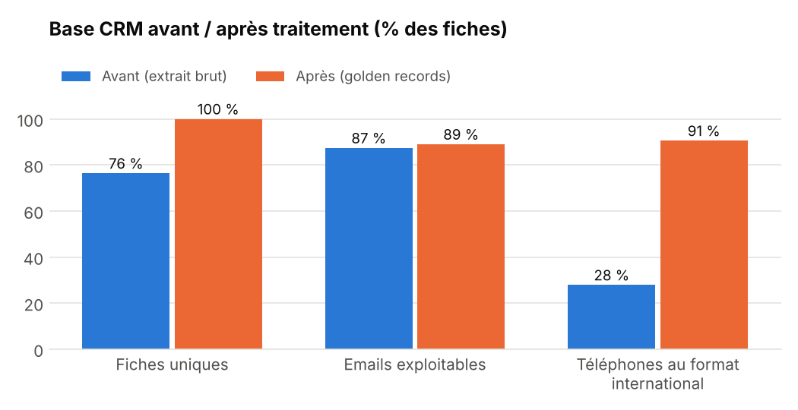
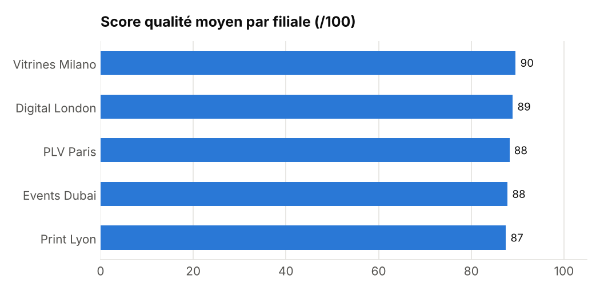
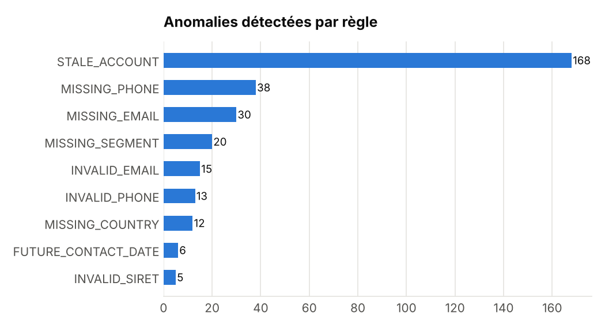

# CRM Data Quality – Fiabilisation d'une base CRM multi-filiales


> 🇬🇧 English summary [below](#english-summary).

Pipeline Python qui **audite, normalise, dédoublonne et score** une base CRM alimentée par plusieurs filiales d'un groupe. Ces filiales (fictives) travaillent pour des marques du luxe à Paris, Lyon, Milan, Londres et Dubaï.

Le cas d'usage : avant de déployer un **CRM Groupe**, il faut consolider les fichiers clients et prospects de chaque filiale. Ces fichiers contiennent des doublons, des formats incohérents et des champs manquants. Ce projet automatise ce travail et produit une base « golden records » propre, un journal des anomalies et un rapport de pilotage.



## Résultats sur l'extrait de démonstration

| Indicateur | Avant | Après |
|---|---|---|
| Fiches | 445 | **392 golden records** (53 doublons fusionnés) |
| Orthographes de sociétés | 183 variantes | **30 sociétés** harmonisées |
| Libellés de pays | 18 variantes | **5 codes ISO** |
| Téléphones au format international (E.164) | 28 % | **91 %** |
| Anomalies tracées | – | **307**, classées par règle et par gravité |
| Fiches à vérifier à la main | – | **80**, signalées par `needs_review` |

## Ce que fait le pipeline

```
Extrait CRM brut (CSV, toutes filiales)
        │
        ▼
1. Normalisation      noms, sociétés (formes juridiques, accents, casse), emails,
                      téléphones → E.164, pays → ISO, dates multi-formats
        │
        ▼
2. Règles qualité     champs obligatoires, email, téléphone, SIRET (clé de Luhn),
                      dates futures, comptes inactifs > 18 mois → journal d'anomalies
        │
        ▼
3. Dédoublonnage      blocking par nom de contact, puis email/téléphone identiques
                      ou similarité floue de la société (RapidFuzz), clustering union-find
        │
        ▼
4. Golden records     une fiche par contact : fiche la plus complète et la plus récente,
                      champs vides complétés par les autres sources, filiales conservées
        │
        ▼
5. Score & reporting  score qualité /100 par fiche et par filiale, graphiques, rapport HTML
```

**Score qualité** = 40 % complétude + 40 % validité (pénalité selon la gravité : bloquant / majeur / mineur) + 20 % unicité.




## Livrables générés (`reports/`)

| Fichier | Contenu |
|---|---|
| `quality_report.html` | Rapport de pilotage autonome : KPI, graphiques, qualité par filiale, exemples de doublons |
| `golden_records.csv` | Base consolidée, prête à importer dans le CRM Groupe |
| `issues_log.csv` | Une ligne par anomalie : fiche, filiale, règle, gravité, valeur fautive |
| `duplicate_pairs.csv` | Paires de doublons avec la raison du rapprochement |
| `subsidiary_summary.csv` | Score, complétude, taux de doublons et anomalies par filiale |
| `record_scores.csv` / `crm_standardized.csv` | Score par fiche et données normalisées avec leur cluster |

## Lancer le projet

```bash
git clone https://github.com/Ferial2998/crm-data-quality.git
cd crm-data-quality
pip install -e ".[dev]"

python -m crm_quality generate          # crée un extrait CRM fictif avec anomalies
python -m crm_quality run               # lance le pipeline → reports/
pytest                                  # 11 tests unitaires
```

Pour l'appliquer à un vrai export CRM, il suffit de fournir un CSV avec les mêmes colonnes : `python -m crm_quality run --input mon_export.csv --output resultats/`.

## Structure

```
src/crm_quality/
├── generate.py      extrait CRM fictif multi-filiales avec anomalies injectées
├── standardize.py   fonctions de normalisation (pures et testées)
├── rules.py         règles qualité déclaratives → journal d'anomalies
├── dedupe.py        blocking, matching flou, union-find, golden records, référentiel sociétés
├── scoring.py       score qualité par fiche et par filiale
├── report.py        graphiques matplotlib et rapport HTML
└── pipeline.py      orchestration de bout en bout
tests/               tests pytest (normalisation, règles, dédoublonnage)
.github/workflows/   intégration continue : tests + exécution du pipeline à chaque push
```

## Stack

Python · pandas · RapidFuzz (similarité de chaînes) · matplotlib · pytest · GitHub Actions

## Pistes d'évolution

- Connecteur direct vers l'API d'un CRM (HubSpot, Salesforce) au lieu d'un CSV
- Enrichissement des fiches via l'API SIRENE (INSEE) à partir du SIRET
- Tableau de bord Looker Studio ou Power BI branché sur `subsidiary_summary.csv`
- Exécution planifiée (hebdomadaire) pour suivre l'évolution du score qualité

> Toutes les sociétés, personnes et coordonnées sont **fictives** et générées aléatoirement.

---

## English summary

A Python pipeline that **audits, standardises, deduplicates and scores** a CRM database fed by several subsidiaries of a (fictional) luxury retail group. It was built as preparation for a Group CRM rollout.

- **Standardisation**: company names, legal forms, accents, e-mails, phone numbers (E.164), countries (ISO), multi-format dates
- **Quality rules**: mandatory fields, e-mail format, phone validity, SIRET checksum, future dates, inactive accounts, all logged by severity
- **Deduplication**: blocking, exact and fuzzy matching (RapidFuzz), union-find clustering, then golden records built with survivorship rules
- **Scoring and reporting**: a 0–100 quality score per record and per subsidiary, with charts and a self-contained HTML report

On the demo extract, 445 records become 392 golden records: 183 company spellings are reduced to 30 companies, and phones in international format go from 28 % to 91 %. All 307 anomalies are traced.

**Author:** Ferial Louni, Data & CRM · [ferial.louni@hotmail.com](mailto:ferial.louni@hotmail.com)
